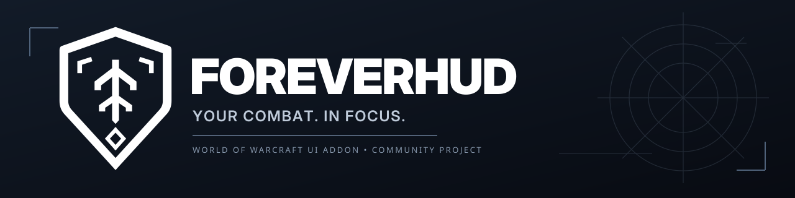
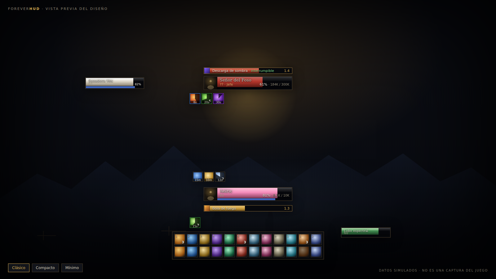
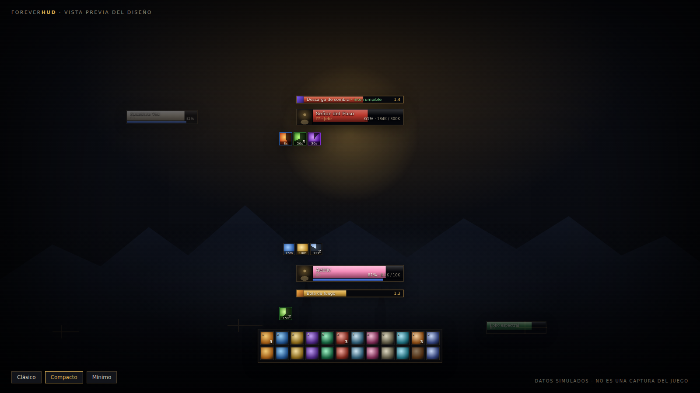
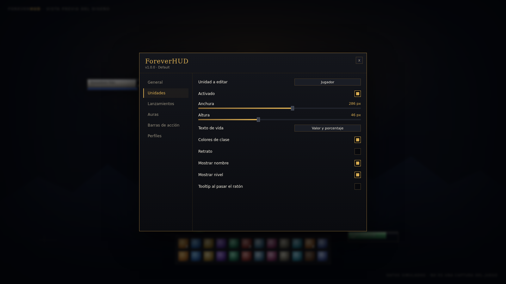
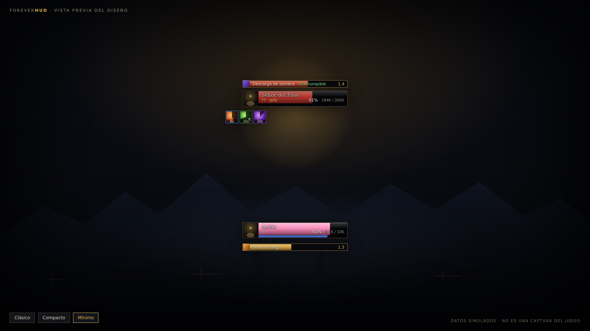

# ForeverHUD

**Un HUD de fantasia oscura, ligero y configurable para World of Warcraft: Forever.**

Sin dependencias. Sin automatizacion. Sin telemetria. Un comando para configurarlo todo.

[Instalacion](#instalacion) · [Capturas](#capturas) · [Comandos](#comandos) · [Configuracion](#configuracion) · [Estado de verificacion](#estado-de-verificacion) · [Vista previa en vivo](https://smouj.github.io/forever-hud/)

---

## Que es ForeverHUD

ForeverHUD recoloca la informacion de combate en el centro de la pantalla con una
estetica de fantasia oscura: marcos de unidad sobrios, barras de lanzamiento con
aviso de interrumpible, auras con barrido de duracion y barras de accion seguras.
Todo vive en un unico complemento Lua, sin librerias ni modulos externos.

Esta pensado para quien quiere un HUD limpio sin montar un ecosistema entero:
instalas una carpeta, escribes **/fh** y ajustas lo que necesitas. Si prefieres
una suite completa con decenas de modulos, ForeverHUD no es eso; si quieres un
HUD de combate cuidado, en espanol y con perfiles por personaje, si.

| Criterio | ForeverHUD | HUD al uso |
| --- | --- | --- |
| Instalacion | Una carpeta o un comando | Varias dependencias |
| Configuracion | Panel propio en espanol e ingles | Paneles en ingles o archivos de texto |
| Dependencias | Ninguna | Librerias compartidas |
| Perfiles | Por personaje, con exportar e importar | Variable |
| Vista previa sin combate | Si, con /fh preview | Rara vez |
| Verificacion sin cliente | 30 pruebas headless | Rara vez |
| Codigo | Lua 5.1 legible, MIT | Variable |

## Capturas

Las imagenes son la **vista previa del diseno** renderizada desde
[preview/index.html](preview/index.html) con datos simulados. No son capturas del
juego: la validacion dentro del cliente esta pendiente y documentada en
[TEST_PLAN.md](TEST_PLAN.md).

<table>
  <tr>
    <td width="50%"> Compacto: mismos datos, menos ruido</td>
    <td width="50%"> Panel de configuracion en el juego</td>
  </tr>
  <tr>
    <td width="50%"> Minimo: solo jugador, objetivo y lanzamientos</td>
    <td width="50%"> Icono del complemento</td>
  </tr>
</table>

## Instalacion

### 1. Instalador para Windows (recomendado)

Descarga el repositorio y ejecuta el instalador. Detecta la carpeta del cliente,
guarda una copia de la version anterior y verifica que se han copiado todos los
ficheros.

    powershell -ExecutionPolicy Bypass -File install\Install-ForeverHUD.ps1

Si el cliente esta en una ruta no habitual:

    powershell -ExecutionPolicy Bypass -File install\Install-ForeverHUD.ps1 -WowPath "D:\World of Warcraft"

Opciones utiles: **-DryRun** muestra lo que haria sin tocar el disco y **-Force**
reemplaza sin conservar la copia de seguridad.

### 2. Manual con el ZIP

1. Descarga **ForeverHUD-1.0.0.zip** desde [Releases](https://github.com/smouj/forever-hud/releases).
2. Descomprime el archivo.
3. Copia la carpeta **ForeverHUD** en:

       World of Warcraft\_forever_\Interface\AddOns\

4. Reinicia el cliente y comprueba que el complemento aparece activado.
5. Escribe **/fh** en el chat.

La estructura final debe quedar asi:

    _forever_\Interface\AddOns\ForeverHUD\
        ForeverHUD.toc
        Core.lua
        Config.lua
        Locales.lua
        Modules\
        Media\

### 3. Linux o macOS (Wine)

    bash install/install.sh "$HOME/Games/World of Warcraft/_forever_/Interface/AddOns"

## Comandos

| Comando | Efecto |
| --- | --- |
| /fh | Abre el panel de configuracion |
| /fh preview | Datos simulados para revisar el HUD sin combate |
| /fh unlock | Libera los marcos para arrastrarlos |
| /fh lock | Bloquea las posiciones y las guarda |
| /fh profile <nombre> | Cambia el perfil activo |
| /fh profiles | Lista los perfiles guardados |
| /fh export | Exporta el perfil activo como texto |
| /fh import <texto> | Importa un perfil |
| /fh reset | Restablece el perfil activo |
| /fh version | Muestra la version instalada |

## Que incluye

| Modulo | Estado | Detalle |
| --- | --- | --- |
| Marcos de unidad | Estable | Jugador, objetivo, foco, mascota y objetivo del objetivo |
| Barras de lanzamiento | Estable | Jugador y objetivo, canales e interrumpibles |
| Auras | Estable | Buffs y debuffs con stacks, duracion y color de dispel |
| Barras de accion | Estable | 1 a 3 filas, ranuras 1-12, 61-72 y 49-60 |
| Panel de configuracion | Estable | Seis secciones, controles en vivo |
| Perfiles | Estable | Por personaje, exportar e importar |
| Vista previa | Estable | /fh preview con datos simulados |

## Configuracion

El panel (**/fh**) se divide en seis secciones:

- **General**: escala global, bloqueo de posiciones, atenuado fuera de combate,
  ocultar marcos de Blizzard, idioma y mensaje de inicio.
- **Unidades**: activar cada marco, anchura, altura, texto de vida, colores de
  clase, retrato, nombre, nivel y tooltip.
- **Lanzamientos**: barra propia y del objetivo, tamano, icono, tiempo e indicador
  de interrumpible.
- **Auras**: tamano, iconos por fila, espaciado, maximo y filtros por grupo.
- **Barras de accion**: filas, botones por fila, tamano, opacidad, atajos y cargas.
- **Perfiles**: perfil activo, crear, copiar, eliminar, restablecer, exportar e
  importar.

Los cambios se aplican al instante y se guardan en **ForeverHUDDB**. Cada
personaje recuerda su perfil. El boton **Recargar interfaz** ejecuta un /reload
cuando cambias el idioma.

## Rendimiento y seguridad

- Un unico **OnUpdate** compartido a 20 Hz alimenta los modulos; solo las dos
  barras de lanzamiento tienen animacion propia.
- Las auras se recalculan con **UNIT_AURA**, no en cada fotograma.
- Las barras de accion usan **SecureActionButtonTemplate** con atributos fijados
  fuera de combate; en combate los cambios se aplazan con **InCombatLockdown**.
- No hay llamadas de red, ni descargas, ni codigo ofuscado. El complemento solo
  escribe en sus SavedVariables.
- No automatiza combate, no pulsa botones y no mueve al personaje.

Limitaciones conocidas de la version 1.0:

- No hay paginacion automatica por forma, sigilo o vehiculo en las barras.
- Los marcos de unidad no seleccionan objetivo al hacer clic.
- La validacion en el cliente real esta pendiente (ver abajo).

## Estado de verificacion

| Comprobacion | Resultado |
| --- | --- |
| Sintaxis Lua de los 9 ficheros | OK |
| Pruebas headless con API simulada | 30 de 30 |
| Estructura del TOC y ficheros declarados | OK |
| ZIP instalable e integridad | OK, 10 entradas |
| CI en GitHub Actions | verde |
| Release con ZIP y SHA256SUMS | v1.0.0 |
| Pruebas dentro del cliente | pendientes |

La suite automatica cubre carga, base de datos, perfiles, marcos de unidad,
eventos, castbars, auras, barras de accion, bloqueo en combate, posiciones,
vista previa, comandos y panel. Ejecutala tu mismo:

    lua5.1 tests/run_tests.lua

La lista de pruebas en el cliente, con pasos y resultados esperados, esta en
[TEST_PLAN.md](TEST_PLAN.md). Si encuentras una diferencia entre lo que promete
este README y lo que hace el complemento, es un fallo: abre un issue.

## Desarrollo

    forever-hud/
      ForeverHUD/            Complemento que se instala
        ForeverHUD.toc       Interface 16001, orden de carga
        Locales.lua          Espanol e ingles
        Core.lua             Base de datos, perfiles, eventos, comandos
        Config.lua           Panel de configuracion
        Modules/             Unidades, castbars, auras, barras
        Media/icon.tga       Icono del addon
      preview/index.html     Vista previa del diseno y capturas
      tests/                 Mock de la API y 30 pruebas
      scripts/               check.sh, build.sh, screenshot.py
      install/               Instaladores de Windows y bash
      .github/workflows/     CI, release y Pages

Comandos de desarrollo:

    bash scripts/check.sh          # sintaxis Lua
    lua5.1 tests/run_tests.lua     # pruebas headless
    bash scripts/build.sh          # dist/ForeverHUD-1.0.0.zip
    python3 scripts/screenshot.py  # regenera las capturas

Reglas y estilo en [CONTRIBUTING.md](CONTRIBUTING.md). Vulnerabilidades en
[SECURITY.md](SECURITY.md).

## Hoja de ruta

- Paginacion de barras por forma, sigilo y vehiculo.
- Seleccion de objetivo con clic, opcional y fuera de combate.
- Ajustes de fuente y texturas por perfil.
- Mas idiomas ademas de espanol e ingles.
- Informe de pruebas en cliente con capturas reales.

## Creditos y aviso legal

Hecho por [SMOUJ](https://github.com/smouj). World of Warcraft es una marca de
Blizzard Entertainment. Este proyecto no esta afiliado ni respaldado por Blizzard
y no incluye arte, sonidos ni codigo del juego.

Licencia [MIT](LICENSE).
